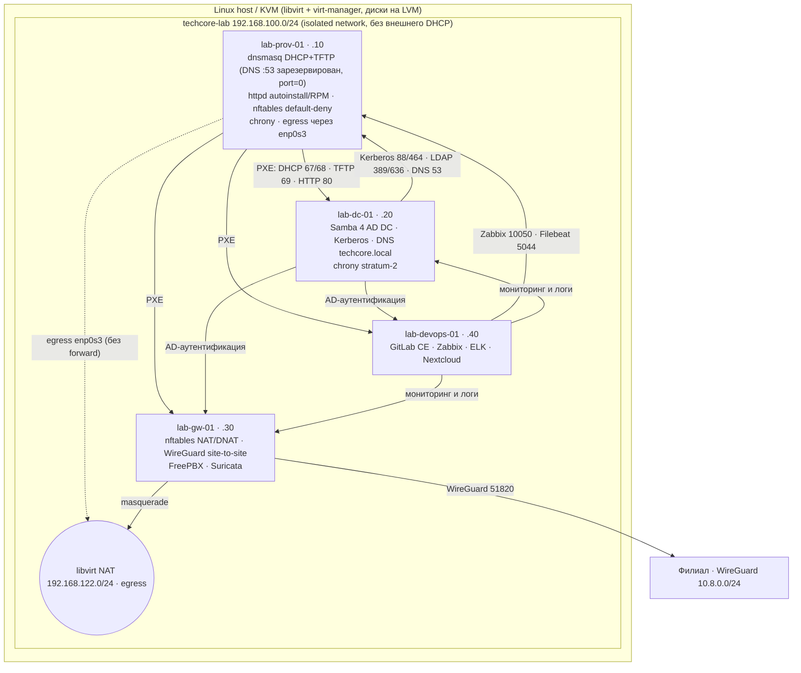
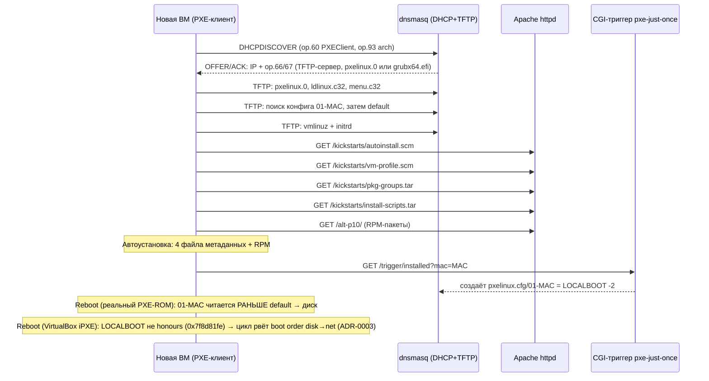

# 🏗️ TechCore Infrastructure Lab

> Корпоративная инфраструктура предприятия, построенная с нуля: от PXE-провижининга
> до GitOps. Поэтапная поставка по техническому заданию
> ГК «Росатом». Всё состояние — в Git, все решения — через ADR, весь провижининг —
> zero-touch.


---

## 📋 Содержание

1. [Контекст и требования ТЗ](#-контекст-и-требования-тз)
2. [Цели и границы проекта](#-цели-и-границы-проекта)
3. [Целевая архитектура](#-целевая-архитектура)
4. [Сетевая топология и адресация](#-сетевая-топология-и-адресация)
5. [Стек и статус фаз](#-стек-и-статус-фаз)
6. [Фаза 1 детально (завершена)](#-фаза-1-детально-завершена)
7. [Стратегия автоматизации](#-стратегия-автоматизации)
8. [Структура репозитория](#-структура-репозитория)
9. [Быстрый старт и воспроизводимость](#-быстрый-старт-и-воспроизводимость)
10. [Безопасность](#-безопасность)
11. [Архитектурные решения (ADR)](#-архитектурные-решения-adr)
12. [Troubleshooting: знаковые случаи](#-troubleshooting-знаковые-случаи)
13. [Инженерные практики](#-инженерные-практики)
14. [Документация и справочники](#-документация-и-справочники)
15. [Демонстрируемые компетенции](#-демонстрируемые-компетенции)
16. [История и статус](#-история-и-статус)
17. [Лицензия](#-лицензия)

---

## 📋 Контекст и требования ТЗ

Проект реализует **техническое задание ГК «Росатом»**
(направление: инфраструктурная автоматизация и DevOps-практики).

**Требования ТЗ:**

| № | Требование | Реализация (фаза) |
| :--- | :--- | :--- |
| 1 | Автоматизация провижининга серверов на отечественных ОС | PXE + autoinstall.scm (ALT-specific), zero-touch (Фаза 1 ✅) |
| 2 | Централизованная идентификация: AD, Kerberos, DNS, MFA | Samba 4 AD DC, SSSD, FreeRADIUS+TOTP (Фаза 2) |
| 3 | Защита периметра: stateful firewall, NAT, site-to-site VPN, IDS, VoIP | nftables, WireGuard, Suricata, FreePBX (Фаза 3) |
| 4 | DevOps-контур: Git, CI/CD, мониторинг, логирование, портал | GitLab CE, Zabbix, ELK, Nextcloud (Фаза 4) |
| 5 | Infrastructure as Code: версионируемость, воспроизводимость | Git → Ansible → GitLab CI/CD + AWX (Фазы 2–5) |
| 6 | Hardening и аудит: egress-контроль, HIDS, compliance, DR | nftables egress, Wazuh, OpenSCAP, restic (Фаза 6) |

**Интерпретация:** ТЗ задаёт целевую архитектуру и стек. Конкретные инженерные
решения — самостоятельная работа автора в рамках ограничений доступности пакетов
целевой ветки ОС: каждое нетривиальное решение зафиксировано как
[ADR](docs/adr/), каждое отклонение от ТЗ — обосновано и задокументировано
(см. [ADR-0003](docs/adr/0003-dnsmasq-over-cobbler.md) и
[ADR-0006](docs/adr/0006-autoinstall-over-kickstart.md)).

---

## 🎯 Цели и границы проекта

**Цели:**
- Построить воспроизводимый стенд корпоративной инфраструктуры (4 серверные ВМ + эфемерные PXE-клиенты).
- Достичь zero-touch провижининга: новая ВМ устанавливается без единого ручного действия.
- Пройти полный жизненный цикл: bootstrap → IaC → GitOps → hardening → DR.
- Задокументировать процесс так, чтобы его можно было передать, аудировать и повторить.

**Границы (осознанно вне скоупа):**
- Продакшен-нагрузки и HA-кластеризация (лабораторный стенд, single-node сервисы).
- Публичные сертификаты и реальные домены (внутренний CA и зона `techcore.local`).
- UEFI-ветка PXE-триггера pxe-just-once (покрыт BIOS/pxelinux; UEFI/grub — future work, зафиксировано в ADR-0003).
- Финальный handoff `LOCALBOOT → диск` верен для PXE-ромов класса SeaBIOS; в VirtualBox iPXE-ром его не выполняет (задокументировано в ADR-0003 и в «Критериях приёмки» как pending на целевом гипервизоре).

---

## 🏛️ Целевая архитектура



### PXE zero-touch: последовательность загрузки новой ВМ



---

## 🧰 Стек и статус фаз

| Фаза | Статус | Стек | Ключевые артефакты |
| :--- | :--- | :--- | :--- |
| **1. Фундамент и провижининг** | ✅ | ALT Linux p10 · KVM (libvirt) · /etc/net · nftables · dnsmasq · syslinux/pxelinux · httpd · autoinstall.scm · chrony | ...
| **2. Идентификация** | ⏳ | Samba 4 AD DC · krb5 · DNS · SSSD · FreeRADIUS+TOTP · chrony-иерархия | `ansible/roles/samba-ad` (в работе) |
| **3. Периметр** | 🔜 | nftables NAT/DNAT · WireGuard · strongSwan · FreePBX/Asterisk · Suricata · VLAN | `ansible/roles/{nftables-gateway,wireguard,freepbx,suricata}` |
| **4. DevOps** | 🔜 | GitLab CE · Docker/Podman · ELK (ES/Logstash/Kibana/Filebeat) · Zabbix 7 · Nextcloud | `ansible/roles/{gitlab,zabbix,elk,nextcloud}` |
| **5. IaC и GitOps** | 🔜 | Ansible · AWX · GitLab CI/CD (shellcheck, ansible-lint, deploy) · дрейф-контроль | `.gitlab-ci.yml`, `ansible/` |
| **6. Hardening и DR** | 🔜 | nftables egress-whitelist · Fail2ban+nft sets · Wazuh · OpenSCAP (CIS) · restic/borg | `ansible/roles/{hardening,wazuh,backup}` |

Детальный план и критерии приёмки каждой фазы: [`docs/roadmap.md`](docs/roadmap.md).

---

## 🔬 Фаза 1 детально (завершена)

**Построено (дизайн принят ADR-0001…0003; статус живьём — ниже):**
- **Dual-homed провижининг-хост:** `enp0s3` = NAT (единственный default route; egress для git/обновлений/chrony), `enp0s8` = изолированный `techcore-lab` 192.168.100.0/24, `lab-prov-01` = `.10` без шлюза; весь PXE-трафик существует только на `enp0s8`, службы привязаны явно (`interface=enp0s8`, `except-interface=enp0s3`, `bind-interfaces`) — [ADR-0001](docs/adr/0001-network-topology-dual-homed.md). Юнит dnsmasq/httpd2 привязан к готовности `enp0s8` (иначе `bind-interfaces` не стартует — ADR-0001, отрицательные последствия).
- **Host-firewall nftables default-deny:** `policy drop` на `input`+`forward`; явные allow на `enp0s8` только для провижининга (udp 67/68/69, tcp 80/443); `forward drop` — хост не роутит между сегментами, опция 3 (router) на `.10` не выдаётся (шлюз появится в Фазе 3 на `lab-gw-01`); мина TFTP закрыта `nf_conntrack_tftp` + явным `tftp-portrange`; мёртвый порт cobbler 25151 удалён из правил — [ADR-0002](docs/adr/0002-nftables-default-deny.md). Детализация SSH/egress-whitelist/Fail2ban — план Фазы 6, не Фаза 1.
- **PXE-стек на dnsmasq + syslinux/pxelinux + CGI-триггер pxe-just-once:** DHCP+TFTP в одном демоне; per-MAC карточки `LOCALBOOT -2` разрываю цикл переустановок (замена cobbler-объекта `system`); **DNS на dnsmasq глушится `port=0`** — порт 53 заранее освобождён под Samba AD на `lab-dc-01` (Фаза 2); EFI/grub-ветка зарезервирована, не развёрнута — [ADR-0003](docs/adr/0003-dnsmasq-over-cobbler.md).
- **Autoinstall ALT p10:** 4 файла метаданных (`autoinstall.scm`, `vm-profile.scm`, `pkg-groups.tar`, `install-scripts.tar`), механизм `ai curl=<каталог>`, `IPAPPEND 2` → `BOOTIF` в cmdline, триггер через `install-scripts.tar` (`preinstall.d` + `postinstall.d`).
- **IaC-каркас:** состояние в Git; повторяемая валидация конфига — `scripts/phase1_preflight.sh` (ADR-0004); факты о сборке берутся из системы, не из туториалов (ADR-0005).

**Критерии приёмки:**
- *Доказано живьём (цепочка zero-touch):* пустая ВМ ставится без единого вопроса; все 4 метаданных отдают `200` гостю; RPM ставятся; триггер пишет per-MAC карточку (`pxe-triggers.log`: `OK 01-<mac> from=<guest-ip>`); логи-цепочка непрерывна `dnsmasq.log → httpd access_log → pxe-triggers.log`.
- *Pending на целевом топологии (gate для тега `phase-1`, ADR-0004):* финальный handoff `pxelinux → LOCALBOOT → диск` на PXE-роме канонического гипервизора; привязка служб к `enp0s8`; `nftables default-deny`; `port=0` на DNS; TFTP-conntrack. На VirtualBox-iPXE `LOCALBOOT` не выполнялся (`0` и `−2` → `Could not boot image 0x7f8d81fe`, ADR-0003) — там цикл рвался boot order `disk→net`; на KVM-ром (SeaBIOS-класс) механизм карточки штатен, но прогон ещё не закрыт.

---

## 🤖 Стратегия автоматизации

Проект осознанно проходит три стадии зрелости IaC:

| Стадия | Фазы | Механизм | Обоснование |
| :--- | :--- | :--- | :--- |
| **Bootstrap** | 1 | Bash-скрипты `scripts/01–04` | PXE/dnsmasq изучаются послойно; ручная настройка даёт понимание протокола, которое невозможно получить из playbook'а |
| **IaC** | 2–4 | Ansible-роли на каждую службу; inventory из `inventory/` | Стандартные задачи (AD, VPN, мониторинг) автоматизируются с самого начала; новая ВМ = роль + playbook |
| **GitOps** | 5–6 | GitLab CI/CD (lint → test → deploy), AWX, дрейф-контроль check-mode | Изменения попадают на хосты только через репозиторий и пайплайн |

Решение зафиксировано: **Ansible вводится с Фазы 2**, а не «после ручного периода»;
Фаза 1 остаётся ручной как учебный bootstrap и эталон для ролей.

---

## 📁 Структура репозитория

```text
techcore-infra/
├── .github/                шаблоны задач фаз и pull request'ов
├── configs/                конфигурации хостов, зеркальные путям на сервере
│   └── lab-prov-01/        (etc/hosts, nftables, dnsmasq, /etc/net)
├── provisioning/           PXE-меню, autoinstall.scm, CGI-триггер pxe-just-once
├── scripts/                bootstrap и деплой из репо (01–04)
├── ansible/                роли, playbook'и, inventory (с Фазы 2)
├── inventory/              учёт ВМ, адресный план, портовая матрица
└── docs/
    ├── adr/                архитектурные решения (контекст → решение → последствия)
    ├── guides/             инженерные справочники (PXE, /etc/net, nftables, autoinstall, репо ALT)
    ├── roadmap.md          фазовая поставка и критерии приёмки
    └── troubleshooting.md  аудиты и разборы инцидентов
```

---

## 🚀 Быстрый старт и воспроизводимость

**Предпосылки:** KVM (libvirt + virt-manager, диски на LVM), ≥ 8 ГБ RAM на хосте, образ ALT Linux p10 Server, isolated-сеть `techcore-lab` без внешнего DHCP. VirtualBox допускается как валидационная среда (см. ROM-оговорки в «Границах» и ADR-0003).

> **Важно о воспроизводимости (ADR-0004):** бинари stage (`altinst` ≈ 500 МБ, `vmlinuz`, `initrd.img`) в Git **не лежат** — только конфиги, метаданные и триггер. Перед `rsync` их надо разложить вручную с ISO в `/var/lib/tftpboot/alt-p10/` и `/var/www/html/alt-p10/` (рецепт — в `configs/lab-prov-01/NOTES-phase1.md`). `phase1_preflight.sh` проверит их наличие и покраснеет, если их нет — это и есть честная граница «клонировал ≠ поднял».

```bash
# 1. Клонировать репозиторий
git clone git@github.com:MatthewAlekseyev/techcore-infra.git && cd techcore-infra

# 2. Разложить бинари stage с ISO (однократно; см. NOTES-phase1.md)
#    -> /var/lib/tftpboot/alt-p10/{vmlinuz,initrd.img}
#    -> /var/www/html/alt-p10/{altinst,ALTLinux/,Metadata/}

# 3. Применить конфиги провижининг-хоста из репо (зеркало путей на сервере)
sudo rsync -av configs/lab-prov-01/ /

# 4. Пересобрать метаданные автоустановки (если менял trigger.sh / группу пакетов)
sudo bash /usr/local/sbin/zt-build-metadata.sh

# 5. Валидация ДО рестарта и ДО коммита (ADR-0004)
sudo bash scripts/phase1_preflight.sh        # должен быть GREEN

# 6. Рестарт служб (только после GREEN)
sudo systemctl restart dnsmasq httpd2 nftables

# 7. Тест zero-touch: пустая ВМ с адаптером в techcore-lab (BIOS, загрузка с сети).
#    Наблюдать цепочку:
tail -f /var/log/dnsmasq.log          # DHCP + TFTP
tail -f /var/log/httpd/access_log     # autoinstall + RPM
tail -f /var/log/pxe-triggers.log     # финиш: MAC -> localboot
```

---

## 🔐 Безопасность

- **Dual-homed сегментация провижининг-хоста:** PXE-стек и внутренние сервисы досягаемы только через `enp0s8` (`techcore-lab`); наружный egress (git, обновления, chrony) — только через `enp0s3` (NAT); хост не роутит между сегментами (`forward drop`, нет opt3) — [ADR-0001](docs/adr/0001-network-topology-dual-homed.md), [ADR-0002](docs/adr/0002-nftables-default-deny.md).
- **nftables default-deny (Фаза 1):** `policy drop` input+forward; allow на `enp0s8` = udp 67/68/69 + tcp 80/443; TFTP-мина закрыта conntrack + `tftp-portrange`; SSH-hardening / egress-whitelist / Fail2ban → nft sets — **план Фазы 6**, не заявляем как сделанное.
- **DNS-резерв:** dnsmasq `port=0` — порт 53 свободен под Samba AD (Фаза 2), провижининг не squats чужой порт (ADR-0003).
- **Секреты:** приватные ключи/токены в репо отсутствуют; `.gitignore` исключает `*.key`, `*.pem`, `secrets/`. Пароль в `autoinstall.scm` — plaintext: осознанное решение для изолированного лабораторного сегмента, а не недоделка. Хэширование пароля в автоустановке ALT p10 не имеет встроенного синтаксиса (ALT Linux Wiki: модули установки принимают только plain text); обходной путь через `chpasswd -e` в `postinstall.d` отложен до прохода hardening (Фаза 6) как не дающий выигрыша в изолированной сети. Фиксация секрета в репозитории — вне scope Фаз 1–2; для прода-контекста — Ansible Vault / ротация после первого SSH (Фаза 5+).
- **Ограничение платформы (доказано live):** iPXE-ром VirtualBox не выполняет `LOCALBOOT` (`0`/`−2` → `0x7f8d81fe`); в лабо-валидации цикл рвался boot order `disk→net`, а per-MAC `LOCALBOOT`-карточка — механизм для реального PXE-рома ([ADR-0003](docs/adr/0003-dnsmasq-over-cobbler.md)).
- Осознанные trade-off помечены в ADR, а не скрыты.

---

## 🧠 Архитектурные решения (ADR)

| ADR | Решение | Статус |
| :--- | :--- | :--- |
| [0000](docs/adr/0000-project-context.md) | Контекст ТЗ, фазовая поставка, ADR-процесс | принято |
| [0001](docs/adr/0001-network-topology-dual-homed.md) | Dual-homed топология провижининг-хоста | принято |
| [0002](docs/adr/0002-nftables-default-deny.md) | Host-firewall default-deny, посегментный least-privilege | принято |
| [0003](docs/adr/0003-dnsmasq-over-cobbler.md) | Пивот Cobbler → dnsmasq по результатам аудита ветки p10 | принято |
| [0004](docs/adr/0004-validate-before-apply-commit.md) | Валидация конфига до применения и до публичного коммита | принято |
| [0005](docs/adr/0005-discover-facts-from-system.md) | Distro-факты узнавать из системы, а не из туториалов | принято |
| [0006](docs/adr/0006-autoinstall-over-kickstart.md) | Формат автоустановки: autoinstall.scm вместо Kickstart (ограничение установщика p10) | принято |
---

## 🩺 Troubleshooting: знаковые случаи

- **Аудит отсутствия cobbler в p10:** доказательная цепочка из 4 замеров (чистый update → свежие noarch-индексы → единственный компонент classic → калиброванный probe по веткам) и матрица отклонённых альтернатив → ADR-0003.
- **Конвенции ALT:** `/etc/openssh/sshd_config` вместо `/etc/ssh`; nftables читает `/etc/nftables/nftables.nft` (ExecReload: flush + include) — оба случая разобраны с объяснением механики.

Полностью: [`docs/troubleshooting.md`](docs/troubleshooting.md).

---

## 🛠️ Инженерные практики

- **Коммиты:** Conventional Commits (`feat|fix|docs|refactor|chore(область): суть`), тело — «почему», а не «что».
- **Релизы:** тег `phase-N` + GitHub Release на каждую закрытую фазу.
- **Ревью-дисциплина:** шаблоны задач фаз и PR (`.github/`); чек-лист PR включает проверку секретов и валидацию конфигов.
- **Источник истины:** конфигурации хостов живут в репозитории (`configs/lab-prov-01/`, зеркало путей на сервере); применение — `rsync -av configs/lab-prov-01/ /` + `scripts/phase1_preflight.sh` (ADR-0004); пересборка метаданных автоустановки — `zt-build-metadata.sh`. Фазы 2+ — через Ansible.
- **Документирование ограничений:** известные пределы решений фиксируются в ADR (пример: UEFI-ветка триггера), а не замалчиваются.

---

## 📚 Документация и справочники

| Документ | О чём | Статус |
| :--- | :--- | :--- |
| [`configs/lab-prov-01/NOTES-phase1.md`](configs/lab-prov-01/NOTES-phase1.md) | Механизм Фазы 1 + грабли (ai+curl, 4 метаданных, IPAPPEND, VBox-iPXE) | ✅ есть |
| [`docs/roadmap.md`](docs/roadmap.md) | Фазы, компоненты, критерии приёмки | 📅 Фаза 2 |
| [`docs/guides/pxe-dnsmasq.md`](docs/guides/pxe-dnsmasq.md) | PXE-цепочка послойно: прошивка → DHCP → TFTP → pxelinux → autoinstall → триггер | 📅 Фаза 2 |
| [`docs/guides/alt-etc-net.md`](docs/guides/alt-etc-net.md) | Сетевая подсистема ALT `/etc/net` | 📅 Фаза 2 |
| [`docs/guides/nftables.md`](docs/guides/nftables.md) | nftables: токены, stateful, TFTP-conntrack, отладка | 📅 Фаза 3 |
| [`docs/guides/autoinstall.md`](docs/guides/autoinstall.md) | Autoinstall ALT p10: ai + curl, 4 файла метаданных, install-scripts.tar | 📅 Фаза 2 |
| [`docs/guides/alt-repositories.md`](docs/guides/alt-repositories.md) | Репозитории ALT: ветки, noarch-ловушка, pinning | 📅 Фаза 2 |
| [`docs/troubleshooting.md`](docs/troubleshooting.md) | Аудиты и разборы инцидентов (cobbler-audit, ALT-конвенции, preflight-красные) | 📅 по мере фаз |
| [`inventory/network.md`](inventory/network.md) | Адресный план и портовая матрица | 📅 Фаза 2 |

---

## 💼 Демонстрируемые компетенции

- **Администрирование Linux (ALT):** пакетная подсистема, systemd, сетевой стек, служебные конвенции дистрибутива.
- **Сетевая инженерия:** сегментация, dual-homed топологии, маршрутизация с единственным default route, DHCP/TFTP/DNS, план адресации и портов.
- **Провижининг:** PXE-цепочка послойно, autoinstall.scm-автоматизация, zero-touch и защита от циклов переустановки.
- **Безопасность:** stateful firewall default-deny, least-privilege по интерфейсам, управление секретами в IaC, план hardening.
- **IaC и GitOps:** репозиторий как источник истины, воспроизводимый деплой, Ansible с Фазы 2, CI/CD и дрейф-контроль с Фазы 5.
- **Работа с требованиями заказчика:** интерпретация ТЗ, управление отклонениями через ADR, доказательные аудиты вместо догадок.
- **Документирование:** ADR, troubleshooting-разборы, справочники — передача знаний как инженерная практика.

---

## 📄 Лицензия

MIT © 2026 Matthew Alekseyev. Подробности: [`LICENSE`](LICENSE).

---

*Автор: Матвей Алексеев · [email](mailto:alekseyevma@gmail.com) · собрано как портфолио-проект по ТЗ ГК «Росатом».*
