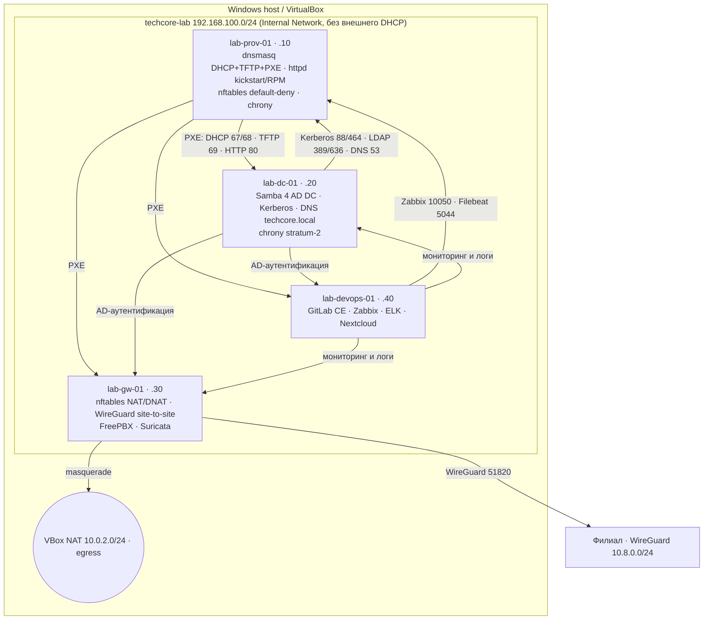

# 🏗️ TechCore Infrastructure Lab

> Корпоративная инфраструктура предприятия, построенная с нуля: от PXE-провижининга
> до GitOps. Поэтапная поставка по техническому заданию
> ГК «Росатом». Всё состояние — в Git, все решения — через ADR, весь провижининг —
> zero-touch.


---

## 📋 Содержание

1. [Контекст и требования ТЗ](#-контекст-и-требования-тз)
2. [Цели и границы проекта](#-цели-и-границы-проекта)
3. [Целевая архитектура](#-целевая-архитектура)
4. [Сетевая топология и адресация](#-сетевая-топология-и-адресация)
5. [Стек и статус фаз](#-стек-и-статус-фаз)
6. [Фаза 1 детально (завершена)](#-фаза-1-детально-завершена)
7. [Стратегия автоматизации](#-стратегия-автоматизации)
8. [Структура репозитория](#-структура-репозитория)
9. [Быстрый старт и воспроизводимость](#-быстрый-старт-и-воспроизводимость)
10. [Безопасность](#-безопасность)
11. [Архитектурные решения (ADR)](#-архитектурные-решения-adr)
12. [Troubleshooting: знаковые случаи](#-troubleshooting-знаковые-случаи)
13. [Инженерные практики](#-инженерные-практики)
14. [Документация и справочники](#-документация-и-справочники)
15. [Демонстрируемые компетенции](#-демонстрируемые-компетенции)
16. [История и статус](#-история-и-статус)
17. [Лицензия](#-лицензия)

---

## 📋 Контекст и требования ТЗ

Проект реализует **техническое задание ГК «Росатом»**
(направление: инфраструктурная автоматизация и DevOps-практики).

**Требования ТЗ:**

| № | Требование | Реализация (фаза) |
| :--- | :--- | :--- |
| 1 | Автоматизация провижининга серверов на отечественных ОС | PXE + kickstart, zero-touch (Фаза 1 ✅) |
| 2 | Централизованная идентификация: AD, Kerberos, DNS, MFA | Samba 4 AD DC, SSSD, FreeRADIUS+TOTP (Фаза 2) |
| 3 | Защита периметра: stateful firewall, NAT, site-to-site VPN, IDS, VoIP | nftables, WireGuard, Suricata, FreePBX (Фаза 3) |
| 4 | DevOps-контур: Git, CI/CD, мониторинг, логирование, портал | GitLab CE, Zabbix, ELK, Nextcloud (Фаза 4) |
| 5 | Infrastructure as Code: версионируемость, воспроизводимость | Git → Ansible → GitLab CI/CD + AWX (Фазы 2–5) |
| 6 | Hardening и аудит: egress-контроль, HIDS, compliance, DR | nftables egress, Wazuh, OpenSCAP, restic (Фаза 6) |

**Интерпретация:** ТЗ задаёт целевую архитектуру и стек. Конкретные инженерные
решения — самостоятельная работа автора в рамках ограничений доступности пакетов
целевой ветки ОС: каждое нетривиальное решение зафиксировано как
[ADR](docs/adr/), каждое отклонение от ТЗ — обосновано и задокументировано
(см. [ADR-0003](docs/adr/0003-cobbler-to-dnsmasq-pivot.md)).

---

## 🎯 Цели и границы проекта

**Цели:**
- Построить воспроизводимый стенд корпоративной инфраструктуры (4 серверные ВМ + эфемерные PXE-клиенты).
- Достичь zero-touch провижининга: новая ВМ устанавливается без единого ручного действия.
- Пройти полный жизненный цикл: bootstrap → IaC → GitOps → hardening → DR.
- Задокументировать процесс так, чтобы его можно было передать, аудировать и повторить.

**Границы (осознанно вне скоупа):**
- Продакшен-нагрузки и HA-кластеризация (лабораторный стенд, single-node сервисы).
- Публичные сертификаты и реальные домены (внутренний CA и зона `techcore.local`).
- UEFI-ветка PXE-триггера pxe-just-once (покрыт BIOS/pxelinux; UEFI/grub — future work, зафиксировано в ADR-0003).

---

## 🏛️ Целевая архитектура



### PXE zero-touch: последовательность загрузки новой ВМ

```mermaid
sequenceDiagram
    participant VM as Новая ВМ (PXE-клиент)
    participant D as dnsmasq (DHCP+TFTP)
    participant H as Apache httpd
    participant T as CGI-триггер pxe-just-once
    VM->>D: DHCPDISCOVER (op.60 PXEClient, op.93 arch)
    D-->>VM: OFFER/ACK: IP + op.66/67 (TFTP-сервер, pxelinux.0 или grubx64.efi)
    VM->>D: TFTP: pxelinux.0, ldlinux.c32, menu.c32
    VM->>D: TFTP: поиск конфига 01-MAC, затем default
    VM->>D: TFTP: vmlinuz + initrd
    VM->>H: GET /kickstarts/alt-p10-server.ks
    VM->>H: GET /alt-p10/ (RPM-пакеты)
    Note over VM: Автоустановка; post: сеть, SSH, /etc/hosts
    VM->>T: GET /trigger/installed?mac=MAC
    T-->>D: создаёт pxelinux.cfg/01-MAC = LOCALBOOT 0
    Note over VM: Reboot: 01-MAC найден РАНЬШЕ default, загрузка с диска
```

---

## 🧰 Стек и статус фаз

| Фаза | Статус | Стек | Ключевые артефакты |
| :--- | :--- | :--- | :--- |
| **1. Фундамент и провижининг** | ✅ | ALT Linux p10 · VirtualBox · /etc/net · nftables · dnsmasq · syslinux/pxelinux · httpd · kickstart · chrony | [`configs/`](configs/), [`provisioning/`](provisioning/), [`scripts/`](scripts/) |
| **2. Идентификация** | ⏳ | Samba 4 AD DC · krb5 · DNS · SSSD · FreeRADIUS+TOTP · chrony-иерархия | `ansible/roles/samba-ad` (в работе) |
| **3. Периметр** | 🔜 | nftables NAT/DNAT · WireGuard · strongSwan · FreePBX/Asterisk · Suricata · VLAN | `ansible/roles/{nftables-gateway,wireguard,freepbx,suricata}` |
| **4. DevOps** | 🔜 | GitLab CE · Docker/Podman · ELK (ES/Logstash/Kibana/Filebeat) · Zabbix 7 · Nextcloud | `ansible/roles/{gitlab,zabbix,elk,nextcloud}` |
| **5. IaC и GitOps** | 🔜 | Ansible · AWX · GitLab CI/CD (shellcheck, ansible-lint, deploy) · дрейф-контроль | `.gitlab-ci.yml`, `ansible/` |
| **6. Hardening и DR** | 🔜 | nftables egress-whitelist · Fail2ban+nft sets · Wazuh · OpenSCAP (CIS) · restic/borg | `ansible/roles/{hardening,wazuh,backup}` |

Детальный план и критерии приёмки каждой фазы: [`docs/roadmap.md`](docs/roadmap.md).

---

## 🔬 Фаза 1 детально (завершена)

**Построено:**
- **Dual-homed провижининг-хост:** `enp0s3` = NAT (DHCP, единственный default route), `enp0s8` = `techcore-lab` (static .10, без шлюза) — [ADR-0001](docs/adr/0001-dual-homed-network.md).
- **Host-firewall default-deny:** stateful ingress, invalid drop+log, SSH по источникам с rate-limit, PXE-стек привязан к `enp0s8` на уровне правил — [ADR-0002](docs/adr/0002-firewall-default-deny.md).
- **PXE-стек на dnsmasq:** DHCP-пул + per-MAC резервы, TFTP, выбор загрузчика BIOS/UEFI по op.60/93, иерархия конфигов pxelinux `01-MAC → default`, режимы SAFE / ZERO-TOUCH — [ADR-0003](docs/adr/0003-cobbler-to-dnsmasq-pivot.md).
- **Kickstart ALT p10:** hashed rootpw, dual-homed сеть в `%post`, `/etc/hosts` под будущий Kerberos, триггер pxe-just-once.
- **IaC-каркас:** всё состояние в Git; единая точка применения — `scripts/04_deploy_from_repo.sh`.

**Критерии приёмки (выполнены):**
- Пустая ВМ в `techcore-lab` устанавливается без единого вопроса.
- После установки и ребута машина грузится с диска (цикл PXE разорван триггером).
- Логи-цепочка непрерывна: `dnsmasq.log` → `httpd access_log` → `pxe-triggers.log`.

---

## 🤖 Стратегия автоматизации

Проект осознанно проходит три стадии зрелости IaC:

| Стадия | Фазы | Механизм | Обоснование |
| :--- | :--- | :--- | :--- |
| **Bootstrap** | 1 | Bash-скрипты `scripts/01–04` | PXE/dnsmasq изучаются послойно; ручная настройка даёт понимание протокола, которое невозможно получить из playbook'а |
| **IaC** | 2–4 | Ansible-роли на каждую службу; inventory из `inventory/` | Стандартные задачи (AD, VPN, мониторинг) автоматизируются с самого начала; новая ВМ = роль + playbook |
| **GitOps** | 5–6 | GitLab CI/CD (lint → test → deploy), AWX, дрейф-контроль check-mode | Изменения попадают на хосты только через репозиторий и пайплайн |

Решение зафиксировано: **Ansible вводится с Фазы 2**, а не «после ручного периода»;
Фаза 1 остаётся ручной как учебный bootstrap и эталон для ролей.

---

## 📁 Структура репозитория

```text
techcore-infra/
├── .github/                шаблоны задач фаз и pull request'ов
├── configs/                конфигурации хостов, зеркальные путям на сервере
│   └── lab-prov-01/        (etc/hosts, nftables, dnsmasq, /etc/net)
├── provisioning/           PXE-меню, kickstart, CGI-триггер pxe-just-once
├── scripts/                bootstrap и деплой из репо (01–04)
├── ansible/                роли, playbook'и, inventory (с Фазы 2)
├── inventory/              учёт ВМ, адресный план, портовая матрица
└── docs/
    ├── adr/                архитектурные решения (контекст → решение → последствия)
    ├── guides/             инженерные справочники (PXE, /etc/net, nftables, kickstart, репо ALT)
    ├── roadmap.md          фазовая поставка и критерии приёмки
    └── troubleshooting.md  аудиты и разборы инцидентов
```

---

## 🚀 Быстрый старт и воспроизводимость

**Предпосылки:** VirtualBox 7+, ≥ 8 ГБ RAM на хосте, образ ALT Linux p10 Server,
внутренняя сеть `techcore-lab` без DHCP.

```bash
# 1. Клонировать репозиторий
git clone git@github.com:ВАШ_НИК_GITHUB/techcore-infra.git && cd techcore-infra

# 2. Бутстрап чистой ВМ ALT p10 (порядок важен)
sudo bash scripts/03_base_packages.sh     # пакеты: ssh, git, dnsmasq, httpd, syslinux
sudo bash scripts/01_init_network.sh      # dual-homed сеть + /etc/hosts
sudo bash scripts/02_ssh_bootstrap.sh     # SSH-доступ (лаба; в Фазе 5 -> ключи+MFA)
sudo bash scripts/04_deploy_from_repo.sh  # репо -> живой хост: конфиги, PXE, триггер

# 3. Тест zero-touch: создать пустую ВМ с адаптером в techcore-lab (Intel PRO/1000,
#    BIOS, загрузка с сети) и включить её. Наблюдать цепочку:
tail -f /var/log/dnsmasq.log          # DHCP + TFTP
tail -f /var/log/httpd/access_log     # kickstart + RPM
tail -f /var/log/pxe-triggers.log     # финиш: MAC -> localboot
```

После установки новая ВМ доступна по адресу из пула .100–.200 (root / хэш из kickstart).

---

## 🔐 Безопасность

- **Default-deny ingress/forward** на всех хостах; службы провижининга досягаемы только из PXE-сегмента (`iifname enp0s8`) — посегментный least-privilege.
- **Stateful-фильтрация** + drop invalid + rate-limit на SSH и на логи дропов (защита от брутфорса и log-flood до появления Fail2ban).
- **Секреты:** в репозитории отсутствуют plaintext-пароли (rootpw в kickstart — только SHA-512 хэш), приватные ключи и токены; `.gitignore` исключает `*.key`, `*.pem`, `secrets/`. VPN-ключи Фазы 3 — только через vault/placeholder.
- **План hardening (Фаза 6):** egress-whitelist (замена `output policy accept`), Fail2ban → nftables sets, Wazuh HIDS, OpenSCAP CIS-профиль, учения DR.
- Осознанные trade-off помечены комментариями в конфигах и ADR, а не скрыты.

---

## 🧠 Архитектурные решения (ADR)

| ADR | Решение | Статус |
| :--- | :--- | :--- |
| [0000](docs/adr/0000-project-context.md) | Контекст ТЗ, фазовая поставка, ADR-процесс | принято |
| [0001](docs/adr/0001-dual-homed-network.md) | Dual-homed топология провижининг-хоста | принято |
| [0002](docs/adr/0002-firewall-default-deny.md) | Host-firewall default-deny, посегментный least-privilege | принято |
| [0003](docs/adr/0003-cobbler-to-dnsmasq-pivot.md) | Пивот Cobbler → dnsmasq по результатам аудита ветки p10 | принято |

---

## 🩺 Troubleshooting: знаковые случаи

- **Аудит отсутствия cobbler в p10:** доказательная цепочка из 4 замеров (чистый update → свежие noarch-индексы → единственный компонент classic → калиброванный probe по веткам) и матрица отклонённых альтернатив → ADR-0003.
- **Конвенции ALT:** `/etc/openssh/sshd_config` вместо `/etc/ssh`; nftables читает `/etc/nftables/nftables.nft` (ExecReload: flush + include) — оба случая разобраны с объяснением механики.

Полностью: [`docs/troubleshooting.md`](docs/troubleshooting.md).

---

## 🛠️ Инженерные практики

- **Коммиты:** Conventional Commits (`feat|fix|docs|refactor|chore(область): суть`), тело — «почему», а не «что».
- **Релизы:** тег `phase-N` + GitHub Release на каждую закрытую фазу.
- **Ревью-дисциплина:** шаблоны задач фаз и PR (`.github/`); чек-лист PR включает проверку секретов и валидацию конфигов.
- **Источник истины:** конфигурации хостов живут в репозитории; применение — только через `scripts/04_deploy_from_repo.sh` (Фазы 2+ — через Ansible).
- **Документирование ограничений:** известные пределы решений фиксируются в ADR (пример: UEFI-ветка триггера), а не замалчиваются.

---

## 📚 Документация и справочники

| Документ | О чём |
| :--- | :--- |
| [`docs/roadmap.md`](docs/roadmap.md) | Фазы, компоненты, критерии приёмки |
| [`docs/guides/pxe-dnsmasq.md`](docs/guides/pxe-dnsmasq.md) | PXE-цепочка послойно: прошивка → DHCP → TFTP → pxelinux → kickstart → триггер |
| [`docs/guides/alt-etc-net.md`](docs/guides/alt-etc-net.md) | Сетевая подсистема ALT `/etc/net`: файлы, параметры, рецепты |
| [`docs/guides/nftables.md`](docs/guides/nftables.md) | nftables: токены, stateful-логика, rate-limit, отладка |
| [`docs/guides/kickstart.md`](docs/guides/kickstart.md) | Kickstart: директивы, %post, отладка установщика |
| [`docs/guides/alt-repositories.md`](docs/guides/alt-repositories.md) | Репозитории ALT: ветки, компоненты, noarch-ловушка, pinning |
| [`inventory/network.md`](inventory/network.md) | Адресный план и портовая матрица |

---

## 💼 Демонстрируемые компетенции

- **Администрирование Linux (ALT):** пакетная подсистема, systemd, сетевой стек, служебные конвенции дистрибутива.
- **Сетевая инженерия:** сегментация, dual-homed топологии, маршрутизация с единственным default route, DHCP/TFTP/DNS, план адресации и портов.
- **Провижининг:** PXE-цепочка послойно, kickstart-автоматизация, zero-touch и защита от циклов переустановки.
- **Безопасность:** stateful firewall default-deny, least-privilege по интерфейсам, управление секретами в IaC, план hardening.
- **IaC и GitOps:** репозиторий как источник истины, воспроизводимый деплой, Ansible с Фазы 2, CI/CD и дрейф-контроль с Фазы 5.
- **Работа с требованиями заказчика:** интерпретация ТЗ, управление отклонениями через ADR, доказательные аудиты вместо догадок.
- **Документирование:** ADR, troubleshooting-разборы, справочники — передача знаний как инженерная практика.

---

## 📄 Лицензия

MIT © 2026 Matthew Alekseyev.Подробности: [`LICENSE`](LICENSE).

---

*Автор: Матвей Алексеев · [email](mailto:malekseyev@gmail.com) · собрано как портфолио-проект по ТЗ ГК «Росатом».*
